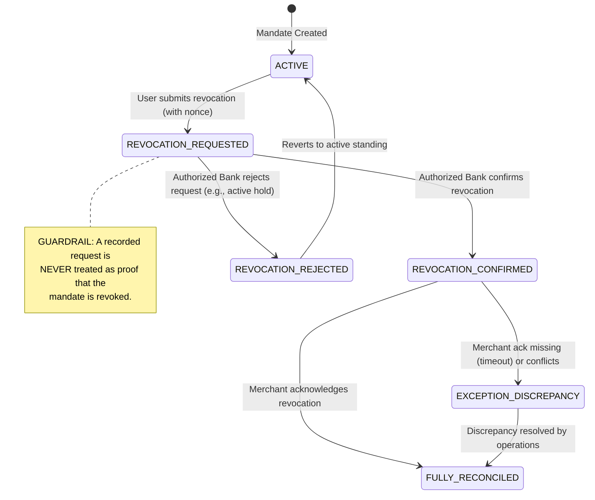
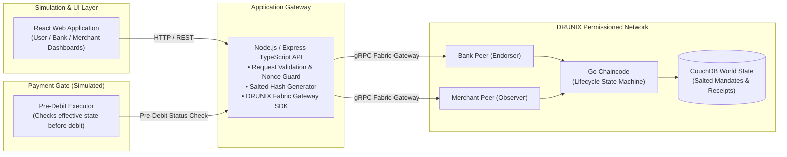

# MandateGuard
### Cross-Participant Proof of UPI AutoPay Revocation

[](#11-current-implementation-status)
[](#1-project-overview)
[](#1-project-overview)
[](docs/architecture.md)
[-orange.svg)](docs/pitch-deck.pdf)

> **Important Notice:** MandateGuard is a hackathon proposal and design-stage proof-of-concept. It uses simulated participants and test environments. It does **not** claim live NPCI, UPI, or core banking integration, nor does it claim that UPI currently lacks revocation capabilities. Actual debit prevention requires enforcement by the responsible payment executor.

---

## 1. Project Overview

**MandateGuard** is a proposed decentralized verification and reconciliation layer built on **DRUNIX** (the National Payments Corporation of India's distributed ledger platform). It provides an immutable, cross-participant audit trail for UPI AutoPay mandate revocations, establishing verifiable coordination between users, mandate-handling issuing banks, payment aggregators, and merchants.

- **Project Name:** MandateGuard
- **Tagline:** Cross-Participant Proof of UPI AutoPay Revocation
- **Selected Theme:** Real-Time Payments
- **Hackathon:** Citi × NPCI DRUNIX Hackathon (Stage 2)
- **Repository:** [github.com/mridulrajgaria/mandateguard](https://github.com/mridulrajgaria/mandateguard)
- **Presentation:** [MandateGuard Pitch Deck (PDF)](docs/pitch-deck.pdf)

---

## 2. Problem Statement

UPI AutoPay already includes comprehensive mandate lifecycle management protocols, including mandate modification and revocation (e.g., codified in **NPCI UPI OC-223/2025-26**, dated 7 October 2025). 

MandateGuard does **not** claim that UPI lacks revocation functionality, nor that mandate status mismatches are a proven widespread defect. Instead, MandateGuard investigates a specific **operational reconciliation challenge**:

When a customer revokes a recurring mandate, multiple independent institutions—the user's issuing bank, the payment service provider (PSP), third-party aggregators, and the merchant's subscription engine—must align their internal databases. In multi-party architectures:
1. **Request ≠ Effective Outcome:** A revocation request submitted by a user is not identical to an effective revocation approved by the mandate authority.
2. **Asymmetric Operational Records:** Disparate participants log asynchronous updates in private ledgers, complicating post-incident root-cause analysis when recurring debits inadvertently process before merchant synchronization completes.
3. **Absence of Shared Verifiable Receipts:** Support desks and customers often lack a single, cryptographically provable receipt referencing the exact sequence of request, authoritative confirmation, and participant acknowledgements.

**Goal:** Provide an immutable, cross-participant verification layer to record the authorized event sequence, flag operational discrepancies in real time, and supply verifiable receipts for dispute resolution.

---

## 3. Proposed Solution & Intended Users

MandateGuard introduces a DRUNIX-backed state-machine layer that governs mandate revocation transitions with cryptographically attributable events:

```
[01 REQUEST]  ───▶  [02 CONFIRM]  ───▶  [03 RECONCILE & VERIFY]
Client logs intent   Mandate authority    Downstream participants
with idempotency     confirms outcome     ack; exceptions open on mismatch;
key & audit hash     & effective time     verifiable receipts issued
```

### Intended Users & Stakeholders

| Participant | Role | Value Received |
| :--- | :--- | :--- |
| **Mandate-Handling Banks** | Issuing Authority / Decision Engine | Retains exclusive legal authority over mandate decisions; minimizes dispute triage overhead via shared audit proofs. |
| **Merchants & Aggregators** | Subscription / Billing Systems | Obtains indisputable, timestamped mandate status notifications to synchronize subscription state and prevent billing disputes. |
| **End Users / Consumers** | Mandate Initiators | Receives a cryptographically signed, verifiable revocation receipt linking request submission, bank approval, and effective timestamp. |
| **Dispute & Reconciliation Teams** | Operational Auditors | Instant visibility into missing or conflicting participant acknowledgements without manual multi-party log aggregation. |

---

## 4. Key Features

- **Mandate Lifecycle State Machine:** Enforces deterministic state transitions (Requested $\rightarrow$ Confirmed/Rejected $\rightarrow$ Reconciled/Exception).
- **Organization-Authorized Transitions:** Uses DRUNIX multi-organization endorsement policies; only the designated mandate-handling bank can authorize the `REVOCATION_CONFIRMED` transition.
- **Duplicate-Request Protection (Idempotency):** Prevents replay attacks and duplicate submissions through client nonces and chaincode-level idempotency indexing.
- **Cross-Participant Acknowledgement & Discrepancy Tracking:** Flags an `EXCEPTION_DISCREPANCY` if downstream merchant systems do not acknowledge within SLA or submit conflicting statuses.
- **Verifiable Revocation Receipts:** Issues receipts with Merkle block references, transaction hashes, and authority timestamps, verifiable both online and offline.
- **Simulated Payment Executor Gate:** A simulated pre-debit check demonstrating that a payment engine querying MandateGuard will block scheduled debits once revocation is confirmed effective.
- **Privacy-Conscious Architecture:** Zero raw Personally Identifiable Information (PII) or plaintext UPI IDs on the shared ledger; relies on salted cryptographic hashes and off-chain private data.

---

## 5. Mandate Lifecycle & State-Transition Rules



### State Transition Governance Rules

1. **Rule 1 (Authority Separation):** Only the designated mandate-handling participant (Issuing Bank MSP) can transition an item from `REVOCATION_REQUESTED` to `REVOCATION_CONFIRMED` or `REVOCATION_REJECTED`.
2. **Rule 2 (No Premature Status):** A submitted request alone is strictly logged as `REVOCATION_REQUESTED` and must never be interpreted as an effective cancellation.
3. **Rule 3 (Idempotency Guard):** Submissions bearing an existing `idempotency_key` return the existing committed state without creating new lifecycle transactions.
4. **Rule 4 (Non-Destructive Exceptions):** Missing or conflicting participant acknowledgements do **not** overwrite the effective status; they trigger an `EXCEPTION_DISCREPANCY` audit ticket.
5. **Rule 5 (Effective Time Invariance):** The `effective_timestamp` recorded by the bank authority is immutable once committed to the ledger block.

---

## 6. How DRUNIX is Intended to Be Used

DRUNIX provides the permissioned, multi-party consensus foundation for MandateGuard:

- **Endorsement & Commit Separation:** The platform separates transaction execution/endorsement (handled by participating banks and aggregators) from block ordering and commitment, ensuring high throughput and strict organizational governance.
- **Go Chaincode:** Implements the mandate state machine, role validation, idempotency guards, and receipt verification logic.
- **Multi-Organization Endorsement Policies:** Guarantees that critical lifecycle transitions require cryptographic signatures from configured peer identities (e.g., `BankMSP` AND `OperatorMSP`).
- **State Database (CouchDB):** Enables rich JSON queries on salted mandate references, active exception statuses, and participant acknowledgement tracking (subject to DRUNIX platform environment compatibility).
- **KeyDB Transient Store:** Referenced per NPCI DRUNIX architecture for high-throughput transient caching and in-flight request deduplication.
- **Guiding Principle:** *The ledger proves the recorded sequence of authorized submissions—it does not claim to magically establish the truth of external statements.*

---

## 7. Proposed Technology Architecture



For complete technical specifications, sequence diagrams, failure handling modes, and privacy models, refer to [docs/architecture.md](docs/architecture.md).

---

## 8. Privacy & Security Considerations

- **No Plaintext PII on Ledger:** In strict compliance with Indian Digital Personal Data Protection (DPDP) standards, customer names, phone numbers, and Virtual Payment Addresses (`example@upi`) are **never** written to the shared ledger.
- **Salted Hash Identifiers:** Unique Mandate Numbers (UMNs) are hashed with keyed salts (`HMAC-SHA256(UMN, SecretSalt)`) before storing state keys on CouchDB.
- **Private Data Collections / Off-Chain Storage:** Confidential contractual terms and dispute details remain stored off-chain or in restricted private data collections, with only cryptographic commitments anchored to the ledger.
- **Access Control & Audit:** Transaction proposals are rejected if the client identity does not match the authorized MSP attributes for the requested transition.

---

## 9. Planned Prototype Demonstration

During evaluation, judges can validate MandateGuard across five reproducible test scenarios:

| # | Scenario | Tested Mechanism | Expected Output |
| :---: | :--- | :--- | :--- |
| **A** | **Normal Revocation Flow** | User request $\rightarrow$ Bank authority approval $\rightarrow$ Merchant ack $\rightarrow$ Receipt generation | Mandate moves to `REVOCATION_CONFIRMED`; valid cryptographic receipt emitted. |
| **B** | **Delayed / Missing Ack** | Merchant fails to submit acknowledgement within simulation SLA | System transitions to `EXCEPTION_DISCREPANCY`; state is **not** falsely marked reconciled. |
| **C** | **Replay / Duplicate Attack** | Resubmission of identical request or out-of-order transition | Idempotency guard rejects replay; returns cached original receipt without state mutation. |
| **D** | **Tampered Receipt Check** | Modification of receipt payload (e.g., altered timestamp or status) | Verification engine flags hash mismatch against DRUNIX block record. |
| **E** | **Post-Revocation Debit Gate** | Simulated payment executor attempts scheduled debit on revoked mandate | Executor queries state, detects confirmed revocation, and **aborts debit scenario**. |

---

## 10. Testing & Validation Plan

- **Go Chaincode Unit Tests:** Comprehensive table-driven tests in Go verifying state machine transitions, role enforcement, and invalid mutation rejections.
- **Integration Tests:** Node.js/Supertest suites testing API idempotency, payload validation, and gateway error handling.
- **Fault Injection:** Automated simulation scripts asserting that network disconnects, duplicate requests, and unauthorized MSP calls fail gracefully.
- **Receipt Verification Utility:** Independent verification script validating that receipt Merkle roots match the block header hash.

---

## 11. Current Implementation Status

| Milestone | Status | Description |
| :--- | :---: | :--- |
| **Problem Definition & Architecture** | **Completed** | Full specification of lifecycle state machine, trust boundaries, and DRUNIX role separation. |
| **Technical Documentation** | **Completed** | Architecture document ([docs/architecture.md](docs/architecture.md)) and pitch deck ([docs/pitch-deck.pdf](docs/pitch-deck.pdf)). |
| **Repository Initialization** | **Completed** | Clean structure, `.gitignore`, and Git baseline ready for prototype implementation. |
| **Go Chaincode Implementation** | *Planned* | 12-day build plan phase 1. |
| **Node.js API & DRUNIX Gateway** | *Planned* | 12-day build plan phase 2. |
| **Simulation UI & Payment Executor** | *Planned* | 12-day build plan phase 3. |

---

## 12. Known Limitations & Dependencies

- **Trust Boundary & Real Debit Prevention:** MandateGuard provides an authoritative verification oracle. Actual debit prevention in production requires integration into the live payment switch or core banking payment engine. The hackathon project demonstrates this boundary via a **simulated payment executor**.
- **Platform Dependencies:** Prototype delivery is dependent upon access to the official NPCI DRUNIX dev/test network, container images, and SDK toolchain.
- **Simulated Environment:** All bank, merchant, and user interactions use synthetic test data. No live NPCI or production banking connections are implied.

---

## 13. Planned Development Roadmap

A targeted **12-day prototype build plan** (Estimated prototype budget: ₹2,000 for local/cloud dev compute):

```
Days 1–3:   Go Chaincode State Machine & Unit Test Suite
Days 4–6:   DRUNIX Network Setup, MSP Identities & CouchDB Config
Days 7–8:   Node.js API Gateway, Idempotency Cache & Receipt Generator
Days 9–10:  React Simulation Dashboard & Simulated Payment Executor
Days 11–12: End-to-End Scenarios (A–E) Hardening, Video Walkthrough & Submission
```

---

## 14. Repository Structure

```
mandateguard/
├── .gitignore               # Sensible exclusions for Node, Go, React, Python & secrets
├── README.md                # Project overview, lifecycle rules, and hackathon guide
└── docs/
    ├── architecture.md      # In-depth architectural design, sequence diagrams & trust model
    └── pitch-deck.pdf       # Hackathon pitch presentation deck
```

*Note: Directory modules (`chaincode/`, `backend/`, `frontend/`, `tests/`) will be populated incrementally as implementation begins according to the 12-day roadmap.*

---

## 15. References & Official Guidance

1. **NPCI UPI Circular OC-223/2025-26** (Dated 7 October 2025) — Operational guidelines on UPI AutoPay mandate lifecycle and execution governance.
2. **NPCI DRUNIX Architecture & Developer Guides** — Multi-organization endorsement specifications, state database configuration, and KeyDB transient caching.
3. **Hyperledger Fabric Documentation** — Permissioned ledger architecture, chaincode lifecycle, and private data collections.
4. **MandateGuard Hackathon Pitch Deck** — Available in this repository at [`docs/pitch-deck.pdf`](docs/pitch-deck.pdf).
