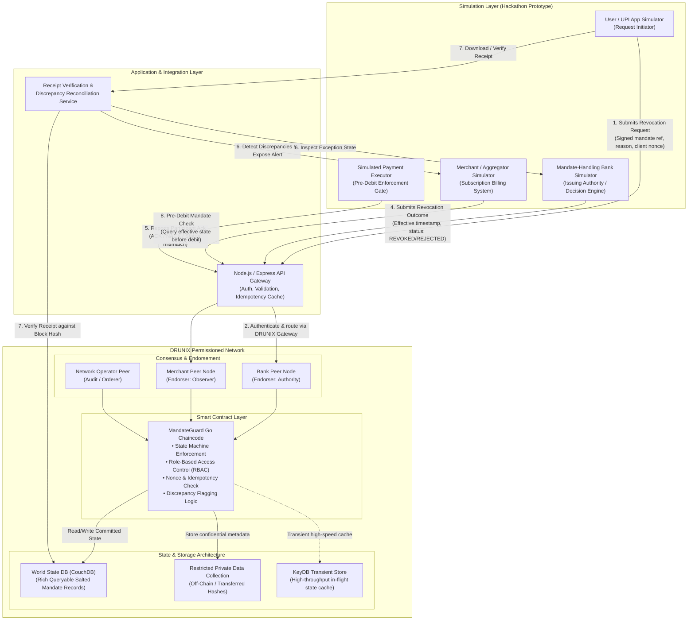

# MandateGuard Architecture Specification

> **Document Status:** Proposal / Design Stage  
> **Project:** MandateGuard — Cross-Participant Proof of UPI AutoPay Revocation  
> **Hackathon Track:** Citi × NPCI DRUNIX Hackathon — Real-Time Payments

---

## 1. System Overview

MandateGuard is a proposed decentralized verification and reconciliation layer built on the **DRUNIX** permissioned distributed ledger platform. It addresses cross-participant operational visibility during UPI AutoPay mandate revocations by establishing an immutable, auditable log of revocation requests, authoritative decisions, and downstream participant acknowledgements.

MandateGuard does **not** replace the existing UPI mandate infrastructure, nor does it assert that UPI lacks revocation capabilities. Rather, it investigates a targeted operational challenge: **enabling disparate participants (issuing banks, payment aggregators, merchants, and users) to maintain a synchronized, tamper-evident proof trail of revocation lifecycle events to prevent and resolve reconciliation discrepancies.**

---

## 2. Architecture Diagram

The diagram below illustrates the end-to-end component topology, data flows, and verification boundaries of MandateGuard:



---

## 3. End-to-End Operational Lifecycle Flow

The MandateGuard state machine separates intent, authoritative execution, and downstream synchronization into discrete, cryptographically accountable phases.

```mermaid
sequenceDiagram
    autonumber
    actor User as User / UPI App Simulator
    participant API as Node.js API Gateway
    participant DRUNIX as DRUNIX Go Chaincode
    participant Bank as Mandate-Handling Bank
    participant Merch as Merchant / Aggregator
    participant Exec as Payment Executor Simulator

    %% Phase 1: Request
    User->>API: POST /mandates/:id/revoke (Idempotency Key, Mandate Hash)
    API->>API: Validate schema, authenticate client signature, check duplicate key
    API->>DRUNIX: Invoke recordRevocationRequest()
    DRUNIX->>DRUNIX: Assert Mandate Status == ACTIVE; record REVOCATION_REQUESTED
    DRUNIX-->>API: Request event committed with block reference
    API-->>User: HTTP 202 Accepted (Request Receipt Reference: Pending Authority)

    %% Phase 2: Authority Decision
    Bank->>API: POST /mandates/:id/confirm-decision (Auth Signature, Effective Time)
    API->>DRUNIX: Invoke confirmRevocationOutcome() [Bank MSP Endorsement Required]
    DRUNIX->>DRUNIX: Verify Bank Authority MSP identity; Transition status to REVOCATION_CONFIRMED (EFFECTIVE)
    DRUNIX-->>Bank: Revocation Effective event emitted

    %% Phase 3: Cross-Participant Acknowledgement
    DRUNIX-->>Merch: Event notification: Revocation Effective
    Merch->>API: POST /mandates/:id/acknowledge (Ack Status, Timestamp)
    API->>DRUNIX: Invoke recordParticipantAck()
    alt Merchant Acknowledges Promptly
        DRUNIX->>DRUNIX: Update status to FULLY_RECONCILED
    else Merchant Delayed or Contradictory Status
        DRUNIX->>DRUNIX: Raise EXCEPTION_DISCREPANCY (Unacknowledged / Conflicting)
    end

    %% Phase 4: Receipt Verification
    User->>API: GET /mandates/:id/receipt
    API->>DRUNIX: Query committed lifecycle audit log
    API-->>User: Verifiable Receipt (Merkle proof, state transitions, block timestamp)

    %% Phase 5: Simulated Pre-Debit Enforcement
    Exec->>API: GET /mandates/:id/executable-state
    API->>DRUNIX: Query world state for Mandate ID
    DRUNIX-->>API: Status: REVOCATION_CONFIRMED (EFFECTIVE)
    API-->>Exec: Mandate is REVOKED (Effective: T_eff)
    Exec->>Exec: REJECT Scheduled Debit Attempt (Enforcement Gate Triggered)
```

### Detailed Step-by-Step Breakdown

1. **User Submits Revocation Request:**  
   The user initiates a mandate cancellation via the UPI App Simulator. The payload contains a cryptographic hash of the mandate details (Unique Mandate Number - UMN, masked identifier), client timestamp, cancellation reason code, and a client-generated idempotency key (nonce).
2. **API Authentication and Idempotency Validation:**  
   The Node.js API Gateway authenticates the client token, validates schema integrity, and verifies that the idempotency key has not been processed or is currently in flight.
3. **DRUNIX Records Lifecycle Event (REQUESTED):**  
   The API submits a transaction proposal to DRUNIX peers. The Go chaincode asserts that the mandate is currently in `ACTIVE` state and transitions it to `REVOCATION_REQUESTED`. **Crucially, the mandate is NOT yet effective or revoked.**
4. **Mandate Authority Confirms Effective Outcome:**  
   The designated mandate-handling participant (the issuing bank simulator), which possesses authoritative governance over the account and mandate debit mandate, processes the request and submits an authorized confirmation containing the official `effective_timestamp`. The chaincode enforces endorsement policies verifying the bank's Membership Service Provider (MSP) role before transitioning state to `REVOCATION_CONFIRMED (EFFECTIVE)`.
5. **Participating Systems Report Acknowledgements:**  
   Downstream participants (merchants, aggregators, sponsor banks) receive the event and submit structured acknowledgement receipts (`ACK` with local cancellation timestamp, or `NACK` with dispute code).
6. **Discrepancy Detection & Exception Handling:**  
   If an acknowledgement is missing past a defined SLA window or reflects an incompatible status (e.g., merchant claims active subscription while bank records revocation effective), the chaincode automatically flags an `EXCEPTION_DISCREPANCY` event. The ledger does not mutate history; it surfaces the dispute for reconciliation.
7. **Verifiable Receipt Issuance & Verification:**  
   Any participant or user can request a cryptographically signed receipt containing the ordered event chain, participant signatures, transaction IDs, and block metadata, verifiable offline or online against the DRUNIX ledger state.
8. **Simulated Payment Executor Pre-Debit Enforcement:**  
   When a recurring billing cycle fires, the simulated Payment Executor checks MandateGuard's world state. Because the state is `REVOCATION_CONFIRMED (EFFECTIVE)` with a timestamp prior to the debit execution window, the executor rejects the debit attempt.

---

## 4. Key Architectural Pillars

### 4.1 Strict State Separation: Request vs. Ack vs. Effective Revocation
A primary defect in naive audit tracking is treating a recorded request as proof of cancellation. MandateGuard strictly enforces three distinct lifecycle tiers:

| Tier | Lifecycle State | Authorized Actor | Legal / Operational Meaning |
| :--- | :--- | :--- | :--- |
| **Tier 1: Intent** | `REVOCATION_REQUESTED` | Mandate Holder (User) / PSP | Request is logged with an idempotency key. Mandate remains legally active until confirmed. |
| **Tier 2: Effective State** | `REVOCATION_CONFIRMED` | Mandate-Handling Bank / Authority | The authoritative institution has confirmed the mandate is cancelled as of `effective_timestamp`. |
| **Tier 3: Synchronization** | `FULLY_RECONCILED` / `EXCEPTION_DISCREPANCY` | Merchant / Aggregator / Core Banking | Participants have aligned their local states. Mismatches open verifiable reconciliation exceptions. |

### 4.2 Trust Boundaries & The Oracle Problem
- **Ledger Invariance vs. External Reality:** The blockchain guarantees the immutability and exact sequence of submitted transactions. It **cannot** unilaterally verify whether an external merchant database actually deleted a billing cron job.
- **Enforcement Boundary:** Actual debit prevention requires an active pre-debit check at the payment executor (Bank Switch / NPCI / Core Banking System). MandateGuard provides the authoritative verification oracle; it does not replace the settlement switch. In the hackathon prototype, this boundary is explicitly demonstrated via a **Simulated Payment Executor**.

### 4.3 Authorization & Role-Based Endorsement Policies
DRUNIX leverages Hyperledger Fabric-based permissioning constructs:
- State transitions require specific cryptographic signatures from designated MSPs.
- `confirmRevocationOutcome` strictly requires an endorsement signature from the `BankMSP`. Submissions from unauthorized actors (e.g., merchant attempting to unilaterally override bank revocation) are rejected by chaincode policy validation.

### 4.4 Idempotency & Replay Protection
- To guard against network retries and duplicate user actions, every revocation proposal requires an `Idempotency-Key` (composite of client nonce, masked UMN hash, and user signature).
- Chaincode maintains an idempotency index within the state database. Subsequent submissions with the same key return the original transaction receipt without triggering duplicate state transitions or duplicate exception tickets.

### 4.5 Privacy by Design (No PII on Ledger)
In accordance with Indian Digital Personal Data Protection (DPDP) principles and NPCI security norms:
- **Zero Raw PII on Ledger:** Plain-text UPI IDs (`vpa`), customer names, bank account numbers, or card tokens are **never** committed to the DRUNIX ledger or state DB.
- **Salted Mandate References:** The Unique Mandate Number (UMN) is hashed using a keyed HMAC-SHA256 (`HMAC(UMN, TenantSalt)`) before being written to CouchDB.
- **Transient & Private Data Collections:** Sensitive audit logs or merchant agreement metadata are maintained either off-chain in participant systems or within restricted Private Data Collections, with only the cryptographic data hash anchored to the shared ledger.

### 4.6 Failure Handling & Resilience
- **Network Partitions:** If a merchant node is offline when a revocation is confirmed, the transaction commits successfully on the bank and orderer nodes. When the merchant rejoins, it catches up via the block synchronization stream and submits its retroactive acknowledgement.
- **Conflicting Submissions:** If two contradictory transactions arrive concurrently (e.g., a mandate renewal and a revocation request), transaction ordering ensures deterministic serialization, and chaincode state validation rejects the invalid transition based on read-write set MVCC (Multi-Version Concurrency Control).

---

## 5. Technology Stack Mapping

| Layer | Component | Proposed Technology | Role / Purpose |
| :--- | :--- | :--- | :--- |
| **User & Participant Simulator** | Web Portal & Dashboard | React (Vite), Tailwind CSS | Visual interface to trigger revocations, simulate merchant acks, and verify receipts. |
| **Backend Integration API** | API Gateway | Node.js, Express, TypeScript | REST endpoints, request validation, cryptographic hashing, and DRUNIX SDK client wrapper. |
| **Smart Contract** | Mandate State Machine | Go Chaincode (`fabric-contract-api-go`) | Deterministic state transitions, endorsement rules, idempotency assertions, receipt generation. |
| **Ledger & Consensus** | Distributed State Network | DRUNIX (Permissioned Hyperledger Fabric base) | Multi-organization Byzantine fault tolerance, block commit pipeline, audit immutability. |
| **State Database** | Queryable World State | CouchDB (subject to DRUNIX env compatibility) | Rich JSON querying for mandate state, discrepancy indexes, and participant acknowledgement status. |
| **Transient Cache** | In-flight State & Cache | KeyDB / Redis | High-throughput deduplication cache and ephemeral session manager. |
| **Test Scenarios** | Automated Validation Suite | Jest / Supertest / Go Test | Deterministic simulation of the 5 hackathon proof scenarios (tampering, replays, exceptions). |
